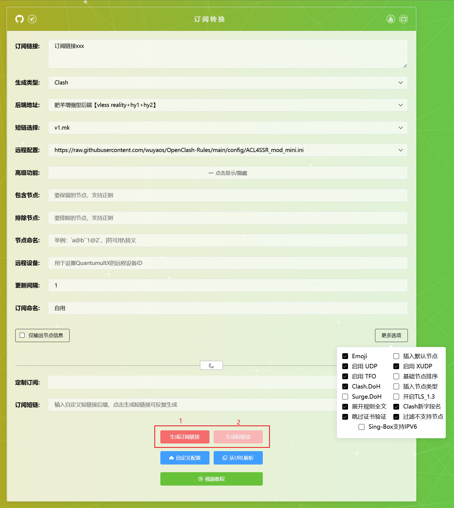

# OpenClash-Rules

# 订阅转换教程

***

## 快速使用

打开[肥羊订阅转换前端](https://suburl.v1.mk/)，填入必要信息（如图所示），用就完事了


***

### 1. 选择订阅转换服务器

> - 用别人搭建好的（因为前端一般不支持自定义后端故以下仅作前端推荐）
  [肥羊](https://sub.v1.mk)、[acl4ssr](https://acl4ssr-sub.github.io/)
> - 自行搭建: [前端项目sub-web-modify](https://github.com/youshandefeiyang/sub-web-modify) | [后端项目subconverter](https://github.com/tindy2013/subconverter)

***

### 2.订阅转换

> 以肥羊前端（https://sub.v1.mk ）为例，解释一下各个参数

> **2.1 订阅链接**  
> 
> > 顾名思义就是把要转换的订阅（必须直接包含节点信息，用已经转换过的放进去套娃是识别不到的哦）> 放进去，可放多个（每行一个或用"|"符号分隔）
> 
> **2.2 生成类型**
> 
> > a. clash：clash系和shadowrocket软件通用  
> > b. 混合订阅（mixed）：混合订阅的意思就是把各类型（包括Shadowsocks、V2ray、Trajon）的节> 点以纯节点信息然后base64加密的方式混在一起，V2ray系和shadowrocket都可用
> 
> **2.3 订阅转换**
> 
> > 点击后开始转换，转换完成后会自动下载转换后的订阅文件（clash格式）
> 
> **2.4 后端地址**
> 
> > 一般只能选提供的后端无法自定义，这里推荐选择肥羊的后端，长期使用下来兼容性和稳定性可以说都> 是最好的
> 
> **2.5 短链选择**
> 
>   > 转换后的订阅地址为后端地址加一系列参数，URL一般较长不甚美观，故可转为短链接  
>   > 自行搭建推荐: [YOURLS](https://github.com/YOURLS/YOURLS)
> 
> **2.6 远程配置**
> 
> > 分流配置，可以选择给定的也可以输入URL自定义分流规则（注意必须是直链才行），自用clash分流> 规则直链地址：https://raw.githubusercontent.com/wuyaos/OpenClash-Rules/main/config/general.ini
> 
> 
> **2.7 高级功能**
> 
> > 高级功能是可选的，可以不选，这里仅作介绍
> > 
> > a. 包含节点
> > 
> >   > * 节点黑名单，只有符合匹配规则的节点才会显示
> >   > 
> >   > * 常用规则
> >   >   
> >   >   * 只用香港节点: HK|香港|Hong Kong
> >   >   
> >   >   * 待补充
> > 
> > b. 排除节点
> >   
> >   > * 节点白名单，符合匹配规则的节点会被筛掉
> >   > 
> >   > * 常用规则
> >   >   
> >   >   * 将官网信息节点和流量信息节点筛掉: 官网|流量
> >   >   
> >   >   * 待补充
> > 
> > c. 节点命名
> >   
> >   > 节点按照一定规则重命名
> > 
> > d. 远程设备
> >   
> >   > 似乎是给QX用的，没用过QX不太清楚
> > 
> > e. 更新间隔
> >   
> >   > 顾名思义
> > 
> > f. 订阅命名
> >   
> >   >  订阅名称，在Clash for Windows一般会显示，其他客户端大多都为自定义
> > 
> > g. 更多选项（右下角）
> >   
> >   > * Emoji: 默认开启
> >   > 
> >   > * 启动UDP: 推荐开启，代理打游戏、打电话时大概率会用到，当然节点也得支持UDP开了才有用
> >   > 
> >   > * 启动TFO: 推荐开启
> >   > 
> >   > * 待补充

### 3. clash软件

***

> 推荐使用
> - [Clash Verge](https://github.com/clash-verge-rev/clash-verge-rev)
> - [mihomo-party](https://github.com/mihomo-party-org/mihomo-party)

***

### 4. 参数化脚本（基于本仓库规则自动生成）

`scripts/unified.js` 是唯一生成的使用脚本：Sub-Store 的订阅操作调用 `operator` 处理节点，文件配置操作及支持脚本覆写的客户端调用 `main` 生成配置。`scripts/gen_script.js` 是生成器，不是客户端使用脚本。

#### 4.1 选择配置

在支持通过脚本链接传递参数的 Sub-Store 操作中，使用：

```text
https://raw.githubusercontent.com/wuyaos/OpenClash-Rules/main/scripts/unified.js#profile=router
```

将 `router` 替换为需要的配置：

| profile | 配置 |
| --- | --- |
| `general` | 通用配置（默认） |
| `router` | 路由器配置 |
| `app-proxy` | Docker 容器、下载软件等应用代理配置 |

其他参数可用 `&` 连接：`ipv6=true` 开启 IPv6；`full=false` 不合并基础配置；`threshold=数字` 按地区组节点数隐藏空组；`groupemoji=false` 去除组名 emoji。默认分别为 `false`、`true`、`0`、`true`。节点处理使用同一套规则，不受 `profile` 切换影响。

旧参数 `acl4ssr` / `acl4ssr_mod_mini` 兼容映射到 `general`，`router_mod_mini` 映射到 `router`。旧 INI 直链删除后将失效，需改用上述配置。

FlClash 等客户端可粘贴 `unified.js` 作为覆写脚本，但切换配置需要运行环境提供 `$arguments`；若不支持传参，将使用默认的 `general`。

#### 4.2 重新生成

在项目根目录执行：

```bash
node scripts/gen_script.js
node -c scripts/gen_script.js
node -c scripts/unified.js
```

生成器读取 `config/*.ini` 和 `clash/config.yaml`，将分组及 ruleset 转换为代理组、rule-provider 和规则，按首次出现顺序去重。GitHub Actions 会在这些输入或生成器变更时更新 `scripts/unified.js`。

### 5. `sync-ruleset.js` 本地自定义补丁

`scripts/sync-ruleset.js` 支持在同步上游规则后，叠加本地补丁文件，避免手工改动在下次同步时丢失。

- 补丁目录：`rules/_custom/`
- 文件命名：
  - `rules/_custom/<source-name>.append.list`
  - `rules/_custom/<source-name>.remove.list`
- 当前 `source-name`：
  - `app-mutated`
  - `game-mutated`
  - `awavenue-ads`

处理顺序：

1. 先按 `remove.list` 删除完全匹配的行  
2. 再按 `append.list` 追加行  
3. 最后自动去重并写回 `rules/*.list`

说明：

- 每行一个规则；
- 空行和以 `#` / `;` 开头的行会被忽略。
